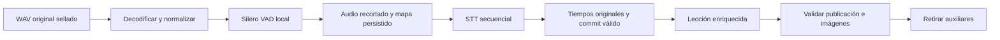

# Biblioteca final y Silero VAD — 16/10/2026

Las **diez clases** de los dos cursos tienen `leccion_final.md`,
`leccion_final.html` autocontenido y únicamente las imágenes referenciadas en `img/`.
Se verificaron **2.313 imágenes** por tamaño y SHA-256. No quedan WAV, estados de
sesión, transcripciones intermedias ni carpetas de depuración dentro de las clases.
Los índices de curso, tareas y resúmenes se conservan porque la aplicación los usa.

## Resultado de la biblioteca

| Curso | Clase | Imágenes publicadas |
| --- | --- | ---: |
| Big Data | 01 — Hadoop | 148 |
| Big Data | 02 | 38 |
| Big Data | 03 — Spark | 235 |
| Big Data | 04 — Semana 4 | 877 |
| Inteligencia Artificial | 01 | 251 |
| Inteligencia Artificial | 02 | 159 |
| Inteligencia Artificial | 03 | 234 |
| Inteligencia Artificial | 04 | 70 |
| Inteligencia Artificial | 05 | 123 |
| Inteligencia Artificial | 06 | 178 |

IA 04 era la única sin final: se consolidaron sus 1.247 segmentos transcritos y ocho
tramos de redacción, conservando el desarrollo enriquecido y las imágenes elegidas.
La consolidación reportó **US$0,0494 estimados** para esa ejecución. No se volvieron
a enviar audios a proveedores STT.

Las otras nueve finales se conservaron. En IA 02 se cerró un enlace Markdown truncado
con dos paréntesis y se corrigió el render general de rutas con guion bajo: una ruta
como `img/consulta_123.jpg` se interpretaba como fórmula y ocultaba la imagen. El texto
académico y todas las imágenes permanecen. Hay un recibo de esa corrección de formato.

La aceptación histórica de IA 05 se realizó conforme a la confirmación del usuario
de que ya recuperó toda la información. Se ligó al SHA-256 exacto de su final y quedó
en el recibo: sus discrepancias antiguas no se reinterpretaron como silencio ni se
borraron del diagnóstico. La aceptación no se activa en clases nuevas y nunca omite
commits STT pendientes, notas pendientes, evidencia posterior o imágenes inválidas.

Se retiraron los **536 WAV restantes** y los auxiliares. Las carpetas de clase pasaron
de 4.364.513.117 a **964.661.171 bytes**: **3.399.851.946 bytes netos liberados**
(3,40 GB decimales), después de añadir los HTML que faltaban. El HTML incorpora una
copia de las imágenes para estudiar y compartir sin conexión; esa duplicación es
intencional. Inventario completo: `history/library-final-20261016.json`.

## Silero integrado y activo

`CLASE_STT_VAD=silero` es el valor predeterminado y está activo en la configuración
efectiva de este proyecto. El modelo oficial **Silero VAD 6.2.3**, de 2,33 MB, se
incluye con su licencia MIT y SHA-256 verificado en `assets/silero_vad/`. Se ejecuta
mediante ONNX Runtime en CPU, con un hilo; no requiere PyTorch, CUDA ni descargas al
iniciar. Fuente y procedencia: [README del modelo](assets/silero_vad/README.md).

La política conserva probabilidades ambiguas y palabras breves. Solo recorta pausas
de al menos dos segundos con probabilidad de voz inferior a 0,20, dejando 400 ms a
cada lado. Si no detecta voz con confianza o falla el runtime, usa el filtro digital
anterior. No descarta un bloque completo solo porque el detector no reconozca voz.

Antes del primer envío se persisten la versión, los intervalos conservados y la
huella del audio preparado. Los reintentos reconstruyen esos mismos bytes sin volver
a ejecutar el modelo. Si la transformación no coincide, se conserva el WAV y se
detiene ese envío. La respuesta STT se proyecta al reloj original antes de alinearla
con las imágenes. La cadena gratuita sigue siendo AssemblyAI → Deepgram →
Speechmatics → Groq, sin solicitudes paralelas para el mismo bloque.

La comparación offline usó 40 audios de las clases restantes antes de purgarlas,
con 1.200 segundos en total:

| Variante | Segundos enviados | Reducción |
| --- | ---: | ---: |
| Sin recorte | 1.200,000 | — |
| Filtro digital anterior | 1.180,694 | 1,61 % |
| Silero conservador | 1.149,760 | **4,19 %** |

Silero retiró 30,934 segundos adicionales respecto del filtro digital y empleó
5,85 segundos de procesamiento local para la muestra. No hubo llamadas API.
La muestra es distinta de la auditoría anterior porque aquellas clases ya habían
sido compactadas. No se extrapola a todas las clases ni se afirma exactitud perfecta:
es una medición de duración y cómputo, no una evaluación humana palabra por palabra.
Evidencia: `history/silero-benchmark-20261016.json`.

## Prevención de las causas identificadas

- La admisión de una adquisición comparte bloqueo con Pausa/Fin. Si la pausa ya se
  confirmó, un estado leído antes no puede registrar otra adquisición. Cambiar parte,
  velocidad o fuente también invalida esa lectura antigua.
- Cobertura usa el comienzo PCM del manifiesto, igual que STT. El nombre del WAV es
  una reserva de adquisición y ya no sustituye ese reloj cuando existe información
  verificada. Esto eliminó los falsos WAV sin texto cercano de IA 05.
- Los trabajos aceptados se recuperan antes de abrir otro proveedor; las cuotas y
  esperas se mantienen. Los mapas VAD persistidos evitan cambiar de reloj al reiniciar.
- La limpieza ordinaria conserva sus verificaciones. Un fallo nuevo de red, hardware
  o persistencia no se convierte automáticamente en una excepción histórica.
- El render distingue URLs de expresiones matemáticas y contiene enlaces truncados
  para que no consuman los párrafos siguientes.

Estas medidas cierran los defectos reproducidos. No se promete ausencia absoluta de
fallos futuros de hardware o proveedores; ante evidencia incompleta se conserva el
material en lugar de anunciar una limpieza correcta.

## Entorno y validación

Se reparó `.venv` con Python 3.12.10 oficial de NuGet, instalado localmente en
`.runtime/python312/tools`. `pip check` pasó y el arranque por `ClaseViva.vbs` vuelve
a disponer del intérprete esperado. La carpeta `.runtime` es una dependencia real
de este entorno, no un temporal. Procedencia: `history/python-runtime-20261016.json`.

La suite completa pasó con **820 pruebas** tras la integración de VAD y admisión de
captura. Los últimos ajustes de render y diagnóstico portable pasaron además las
**31 pruebas focales** correspondientes. Ruff pasó sobre todos los módulos modificados.
Las pruebas STT usan proveedores simulados; la consolidación real de IA 04 utilizó
la API de redacción configurada. No se simuló una clase de varias horas con hardware
real ni se gastó cuota STT para el benchmark.

Recibos relevantes:

- `history/cleanup-CLASE_04_clase-3-1792211836253311600.json`.
- `history/cleanup-CLASE_05_clase-semana-4-1792211845491805000.json`.
- `history/IA02-format-repair-20261016.json`.
- `history/library-final-20261016.json`.

## Portable actualizado y limpieza del proyecto

La entrega actual es [dist/ClaseViva-Portable.zip](dist/ClaseViva-Portable.zip):
**154.417.578 bytes**, 441 archivos y 356.509.699 bytes descomprimidos.
Su SHA-256 es
`862e5a8a8938d77c14f19d521154740d3e73aab2e47a7e31b466c1c16a15e269`.

Se reconstruyó con Python 3.12 y las dependencias fijadas. Incluye el modelo Silero,
su licencia y las correcciones de esta entrega. Tras extraer el ZIP se comprobaron
los tamaños y hashes de todos sus archivos y se repitió el diagnóstico offline del
ejecutable: inferencia real de Silero en CPU, render de lecciones, PDF/OCR e inicio
y salida de los cuatro workers sin clase activa. Todo pasó. No contiene claves
reales ni el contenido de los cursos. Evidencia:
`history/portable-20261016-manifest.json` y
`history/portable-20261016-delivery.json`.

Se retiraron 269.316.892 bytes de entorno QA obsoleto, carpetas de pruebas y logs
antiguos. Después de verificar el ZIP se eliminaron otros 1.194.776.926 bytes de
compilación, extracción de prueba y cachés generados durante esta tarea. Estas cifras
describen archivos retirados; no se suman al ahorro neto de la biblioteca como si
todos hubieran existido al inicio. El ZIP final, `.venv` reparado, `.runtime`, las
claves, el historial Git y los recibos de auditoría se conservan. Recibos:
`history/project-purge-20261016.json` y `history/build-temp-cleanup-20261016.json`.

## Portable actualizado y limpieza del proyecto

La entrega actual es [dist/ClaseViva-Portable.zip](dist/ClaseViva-Portable.zip):
**154.417.578 bytes**, 441 archivos y 356.509.699 bytes descomprimidos.
Su SHA-256 es
`862e5a8a8938d77c14f19d521154740d3e73aab2e47a7e31b466c1c16a15e269`.

Se reconstruyó con Python 3.12 y las dependencias fijadas. Incluye el modelo Silero,
su licencia y las correcciones de esta entrega. Tras extraer el ZIP se comprobaron
los tamaños y hashes de todos sus archivos y se repitió el diagnóstico offline del
ejecutable: inferencia real de Silero en CPU, render de lecciones, PDF/OCR e inicio
y salida de los cuatro workers sin clase activa. Todo pasó. No contiene claves
reales ni el contenido de los cursos. Evidencia:
`history/portable-20261016-manifest.json` y
`history/portable-20261016-delivery.json`.

Se retiraron 269.316.892 bytes de entorno QA obsoleto, carpetas de pruebas y logs
antiguos. Después de verificar el ZIP se eliminaron otros 1.194.776.926 bytes de
compilación, extracción de prueba y cachés generados durante esta tarea. Estas cifras
describen archivos retirados; no se suman al ahorro neto de la biblioteca como si
todos hubieran existido al inicio. El ZIP final, `.venv` reparado, `.runtime`, las
claves, el historial Git y los recibos de auditoría se conservan. Recibos:
`history/project-purge-20261016.json` y `history/build-temp-cleanup-20261016.json`.
